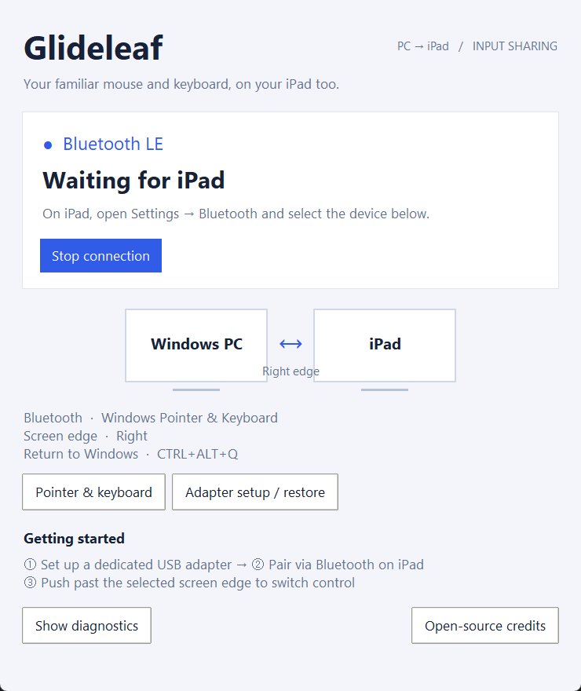

# Glideleaf — share a Windows mouse and keyboard with iPad

[](https://github.com/octxxiii/glideleaf/actions/workflows/test.yml)
[](LICENSE)

**Glideleaf is an open-source Windows app that forwards your PC mouse and keyboard to an iPad over Bluetooth Low Energy.** Push the pointer past a configured screen edge to move control to the iPad; push back or use the emergency shortcut to return to Windows. The iPad sees a Bluetooth mouse and keyboard, so no iPad app is required.

**A dedicated compatible USB Bluetooth adapter is required.** Glideleaf takes over that adapter with WinUSB. It is not a Wi-Fi remote desktop, a screen-mirroring app, or a replacement for every macOS Universal Control feature.

English · [한국어](docs/README.ko.md) · [日本語](docs/README.ja.md) · [简体中文](docs/README.zh-Hans.md) · [繁體中文](docs/README.zh-Hant.md)



*Actual Windows UI with simulated connection state. This screenshot is not evidence of a physical iPad connection.*

## Project status

**Developer preview / alpha.** The implementation includes a tray UI, adapter setup, persistent BLE bonding, screen-edge switching, keyboard mapping and nine UI languages. This fork has automated tests and desktop UI verification. Physical adapter/iPad pairing, long-session input, sleep/resume, and clean-machine installer validation remain open. No production-readiness claim or prebuilt binary release is made.

Glideleaf is an independently maintained derivative of [fuba/winuc](https://github.com/fuba/winuc). Its original Git history and MIT copyright are preserved. Thank you, fuba, for making this project possible.

## Requirements

| Component | Requirement |
| --- | --- |
| PC | Windows 10 or Windows 11 |
| Python | 3.10+ for running from source; CI covers the versions in the workflow |
| USB Bluetooth adapter | A dedicated adapter supported by Bumble; upstream's reference hardware is the Realtek RTL8761B family |
| Driver | WinUSB binding for the adapter used by Glideleaf |
| iPad | iPadOS 13.4+ according to upstream; keyboard shortcuts are better supported on 15+ |
| iPad app / cloud account | Neither is required |

While switched to WinUSB, this adapter cannot also serve headphones, gamepads or other normal Bluetooth devices. Keep another adapter for those devices. Other chipsets listed in the code are candidates, not a claim that this fork has tested them.

## Run from source on Windows

```powershell
git clone https://github.com/octxxiii/glideleaf.git
cd glideleaf
python -m venv .venv
.\.venv\Scripts\python.exe -m pip install -r requirements.txt

# Fetch the Realtek firmware if using a Realtek adapter.
.\.venv\Scripts\bumble-rtk-fw-download.exe --output-dir firmware

# First-time adapter setup. Driver changes require an administrator prompt.
.\.venv\Scripts\pythonw.exe -m glideleaf --setup

# Start the tray app and control panel.
.\.venv\Scripts\pythonw.exe -m glideleaf --tray
```

The original `python -m winuc` entry point is retained for compatibility. `python -m glideleaf` without GUI flags runs the console mode.

### Set up the adapter

The setup window detects a USB Bluetooth adapter. Automatic WinUSB switching requires the optional `wdi-simple.exe` tool. It is **not included** in this source repository. Prefer a verified build from [libwdi](https://github.com/pbatard/libwdi); `scripts/fetch_wdi.ps1` downloads an unofficial community binary and is an explicit opt-in.

Alternatively, run `scripts/setup_dongle.ps1` and follow its Zadig instructions. The setup GUI reports an error if the automatic tool is missing; it does not silently install it. Restore the selected adapter through **Adapter setup / restore** before uninstalling. Do not switch an adapter that you rely on for your only keyboard or mouse.

### Pair and use

1. Start the connection in Glideleaf.
2. On iPad, open **Settings → Bluetooth** and choose **Windows Pointer & Keyboard** (or the Bluetooth name configured in settings).
3. Push past the chosen Windows screen edge to control iPad. The default is the right edge.
4. Push back through the shared edge, or press **Ctrl+Alt+Q**, to return to Windows.

The return position is estimated from sent relative motion. iPadOS applies its own pointer acceleration, so physical-device tuning is still necessary.

## What works in the implementation

| Capability | Implementation / limits |
| --- | --- |
| Mouse, buttons, scrolling | BLE HID reports; speed, natural scrolling and extra-button scroll actions |
| Keyboard and media keys | HID keyboard/consumer reports, Alt/Win remapping and Japanese JIS mappings |
| Screen-edge switching | Push-through resistance, push-back return and emergency shortcut |
| Reconnection | Persisted BLE bonding; physical sleep/resume testing remains open |
| Desktop controls | Tray, connection panel, settings, adapter setup, bounded logs |
| Languages | English, 한국어, 日本語, 简体中文, 繁體中文, Español, Français, Deutsch, Português (Brasil) |
| File drag-and-drop | Not implemented |
| Shared clipboard | Not implemented |
| Screen mirroring / remote desktop | Not provided |

Open **Pointer & keyboard → Language** to choose a language. System-language detection is the default. Language-only changes keep the BLE session running. See [language support and translation contributions](LANGUAGES.md).


## How it works

```text
Windows hooks + Raw Input
        ↓
screen-edge state machine
        ↓
HID mouse / keyboard / media reports
        ↓
Bumble Bluetooth stack → WinUSB USB adapter → BLE HOGP → iPad
```

Glideleaf uses [Google Bumble](https://github.com/google/bumble) to control the adapter in userspace, rather than relying on Windows' normal Bluetooth peripheral APIs. Pairing keys stay on the PC. Input reports travel over the BLE link; the application does not use a cloud relay.

## FAQ

### Is this Universal Control for Windows?

It provides the mouse/keyboard screen-edge interaction that people look for under that phrase. It does not implement Apple's Continuity protocol, file transfer, clipboard sharing or screen mirroring, and is not affiliated with Apple.

### Can I use the built-in Bluetooth radio?

The documented path uses a dedicated USB adapter bound to WinUSB. A normal Windows-managed radio is not a drop-in replacement. Do not assume an internal radio is supported.

### Can I use it without a USB dongle?

Not through the supported setup described here. No-dongle operation is not claimed.

### Does it need Wi-Fi or an iPad app?

Input forwarding uses Bluetooth LE HID. No Wi-Fi relay or iPad-side application is used by this implementation. A separate USB adapter and driver setup are still required on Windows.

### Does it support Japanese keyboards?

The implementation has JIS conversion-key mappings and Alt/Win modifier swapping. Set the matching hardware-keyboard layout in iPadOS. UI language is independent of keyboard layout; actual hardware combinations need testing.

### What data is stored?

For compatibility with upstream, configuration, pairing keys and logs remain in `%LOCALAPPDATA%\WinUC`. The autostart registry value also retains the legacy name. Pairing data is not committed to the repository. Never attach pairing keys to a bug report.

## Development and validation

```powershell
.\.venv\Scripts\python.exe -m pip install -r requirements-dev.txt
.\.venv\Scripts\python.exe -m pytest -q
.\.venv\Scripts\python.exe -m glideleaf --selftest
.\.venv\Scripts\python.exe scripts/verify_gui.py --language ja
```

The virtual BLE integration test pairs two Bumble controllers, discovers HID services, subscribes and checks received reports without a physical adapter. Windows CI runs automated tests; GUI screenshots are local checks with simulated states. These checks do not replace device testing.

See [contributing](CONTRIBUTING.md), [hardware validation](docs/HARDWARE_VALIDATION.md), [security reporting](SECURITY.md), and [changes](CHANGELOG.md).

### USB adapter not detected?

Open **Adapter setup / restore → Copy USB diagnostics** and review the report.
The scan now distinguishes an enumeration error from a successful scan with no
Bluetooth candidates. It checks driver services and Bluetooth HCI identifiers,
rather than assuming every `USBDevice` is a WinUSB Bluetooth adapter.

Alternatively, generate a read-only report without starting BLE or input capture:

```powershell
.\.venv\Scripts\python.exe -m glideleaf --diagnose usb-diagnostics.json
```

If Python is unavailable, the standalone script needs only Windows PowerShell:

```powershell
powershell -NoProfile -ExecutionPolicy Bypass -File scripts/diagnose_usb.ps1 -Copy
```

Paste the reviewed JSON into a bug report together with your adapter model.
Reports omit USB serial suffixes and do not read pairing keys or input logs.
Use the report from the **affected PC**. Detecting a device is separate from
confirming its BLE compatibility; a keyboard/mouse HID receiver is not itself
a USB Bluetooth HCI adapter.

### Build a local executable

```powershell
.\.venv\Scripts\python.exe -m pip install pyinstaller
powershell -ExecutionPolicy Bypass -File packaging/build.ps1
```

Output is `dist/Glideleaf/Glideleaf.exe`. Inno Setup 6 is needed to produce an installer. Build scripts collect installed Python dependency notices; native libraries, firmware and optional driver-tool redistribution still need the review described in [third-party notices](THIRD_PARTY_NOTICES.md). A successful local build is not a release certification.

## License and thanks

Project code is [MIT](LICENSE). Original **Copyright (c) 2026 fuba** remains intact. Third-party dependencies retain their own licenses.

> WinUCを作り、公開してくださったfubaさんに感謝します。あなたの取り組みがGlideleafの出発点になりました。

Thank you, fuba, for creating and sharing WinUC. Glideleaf keeps the upstream history and attribution, and adds multilingual UI, diagnostics and reliability work. This is an independent project, not an official fuba or Apple product.
