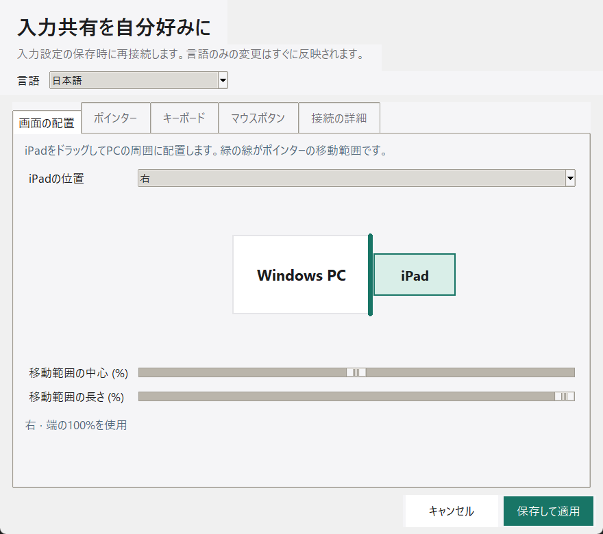

# Glideleaf — WindowsのマウスとキーボードでiPadを操作

Glideleafは、Windows PCのマウスとキーボード入力をBluetooth LEでiPadに送る
オープンソースアプリです。設定した画面の端を押し越えるとiPadに切り替わり、
共有する端に戻すか **Ctrl+Alt+Q** を押すとWindowsに戻ります。
iPadには通常のBluetoothマウス・キーボードとして認識されるため、iPadアプリは不要です。

**専用の対応USB Bluetoothアダプターが必要です。** WinUSBへの切り替え中は、
そのアダプターをイヤホンなど通常のBluetooth機器に使えません。
画面転送、クリップボード共有、ファイルのドラッグ＆ドロップには対応していません。

**現在はアルファ版のソース公開です。** 仮想BLEとWindows UIの検証はありますが、
この派生版での実機接続・スリープ復帰・インストーラーの検証は未完了です。

[English / セットアップ手順](../README.md) · [対応言語](../LANGUAGES.md) · [実機検証状況](HARDWARE_VALIDATION.md)

## 起動

Windows 10/11とPython 3.10以降を用意し、[英語ガイド](../README.md#run-from-source-on-windows)
の手順で依存関係・必要なファームウェア・アダプタードライバーを準備してください。

```powershell
.\.venv\Scripts\pythonw.exe -m glideleaf --setup
.\.venv\Scripts\pythonw.exe -m glideleaf --tray
```

iPadの「設定」→「Bluetooth」で **Windows Pointer & Keyboard** を選んでペアリングします。
日本語JISの変換キー・無変換キーのマッピングを実装しています。
「ポインター・キーボード設定」→「画面の配置」では、iPadをPCの周囲にドラッグして
上下左右の位置を決め、緑色の移動範囲の中心と長さを調整できます。
iPad側のハードウェアキーボード配列も合わせて設定してください。
UIの言語設定とキーボード配列は別です。

「ポインター・キーボード」→「言語」で日本語を選べます。
初期設定はシステム言語の自動選択です。言語だけを変更してもBLE接続は再起動しません。



この画像は実際のWindows UIに仮想の接続状態を表示したものです。実機接続の証明ではありません。

## fubaさんへ

WinUCを作り、公開してくださったfubaさんに感謝します。
あなたの取り組みがGlideleafの出発点になりました。

Glideleafは[fuba/winuc](https://github.com/fuba/winuc)を基にした独立プロジェクトです。
原作者のGit履歴とMITライセンス、Copyright (c) 2026 fubaを保っています。
Appleまたはfubaさんの公式製品ではありません。[ライセンス](../LICENSE)
