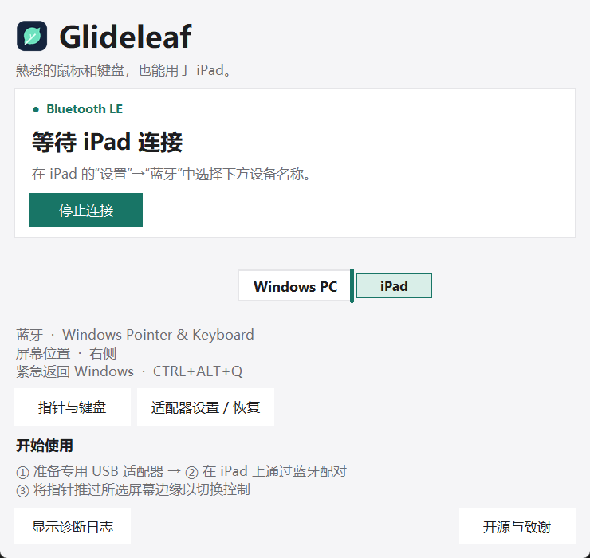

# Glideleaf — 用 Windows 鼠标和键盘控制 iPad

Glideleaf 是一款开源 Windows 应用，通过低功耗蓝牙将电脑的鼠标和键盘输入转发到 iPad。
将指针推过所选屏幕边缘即可切换到 iPad；反向推回或按 **Ctrl+Alt+Q** 可返回 Windows。
iPad 将其识别为普通蓝牙鼠标和键盘，无需安装 iPad 应用。

**需要兼容的专用 USB 蓝牙适配器。** 切换到 WinUSB 后，该适配器不能同时连接耳机、
游戏手柄等普通蓝牙设备。不提供屏幕镜像、共享剪贴板或文件拖放功能。

**目前为 Alpha 源码预览。** 虚拟 BLE 和 Windows UI 已有测试；此分支的真实适配器与
iPad 配对、休眠恢复及安装程序验证尚未完成。

[英文安装指南](../README.md#run-from-source-on-windows) · [语言支持](../LANGUAGES.md) · [硬件验证](HARDWARE_VALIDATION.md)

## 运行

准备 Windows 10/11 和 Python 3.10 或更新版本，按照英文指南安装依赖、所需固件及适配器驱动。

```powershell
.\.venv\Scripts\pythonw.exe -m glideleaf --setup
.\.venv\Scripts\pythonw.exe -m glideleaf --tray
```

在 iPad 的 **设置 → 蓝牙** 中选择 **Windows Pointer & Keyboard** 进行配对。
在应用的 **指针与键盘 → 语言** 中可选择界面语言，默认跟随系统。更改界面语言不会更改键盘布局。
在 **指针与键盘 → 屏幕布局** 中可拖动 iPad 调整其相对于电脑的位置，并设置绿色跨越区域的中心和长度。



这是实际 Windows 界面使用模拟连接状态的截图，不代表已经验证真实 iPad 连接。

## 致谢

感谢 fuba 创建并开源 [WinUC](https://github.com/fuba/winuc)。您的工作让 Glideleaf 成为可能。
本项目保留原始 Git 历史、MIT 许可证及 Copyright (c) 2026 fuba。
这是独立衍生项目，并非 Apple 或 fuba 的官方产品。[许可证](../LICENSE)
